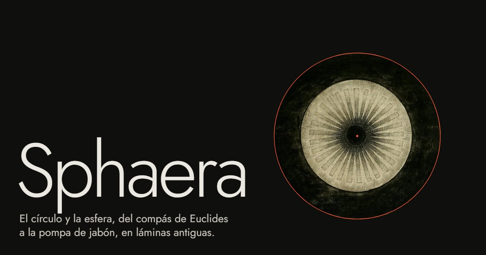

# Sphaera

**El círculo y la esfera con el scroll, del compás de Euclides a la pompa de jabón, en láminas antiguas.**

Un punto y una distancia que no cambia: con eso empieza la geometría del círculo. Sphaera la recorre en una sola bajada de scroll, con 58 láminas de dominio público del siglo XII a 1909 y figuras geométricas que se mueven con la posición de la página.

En vivo: **[pedrogomez.dev/proyecto/sphaera](https://pedrogomez.dev/proyecto/sphaera/)**



## Qué hay dentro

- **La portada.** Un punto rojo. Al bajar, el brazo de un compás da la vuelta y deja el círculo; dentro se abre la luz que Robert Fludd hace brotar de la oscuridad (1617).
- **Un centro y una distancia.** La definición 15 de Euclides y sesenta y cuatro radios que se doblan (1, 2, 4… 64), todos iguales, hasta que el borde pasa por sus puntas. Después, Durero, Hirschvogel y el brazo de Delsarte.
- **Tres veces y un poco más.** El círculo entre dos polígonos de 6, 12, 24, 48 y 96 lados, como lo hizo Arquímedes, con la tabla de perímetros calculada.
- **Círculos sobre círculos.** Diez fotografías de torneado de fantasía de Edward J. Woolsey (1869) que cruzan la pantalla girando. Las ondas en un cuenco y las figuras de Chladni.
- **Un círculo que gira.** La esfera sale de girar un círculo sobre su diámetro; después, los dos tercios de Arquímedes en el cilindro. Jamnitzer, Stöer, Hirschvogel y Gillray.
- **Una tumba para Newton.** El cenotafio esférico de Boullée (1784) pasa del efecto de día al de noche.
- **Esferas dentro de esferas.** Ptolomeo, Copérnico y Kepler en el mismo dibujo: las órbitas se recentran de la Tierra al Sol y luego se vuelven elipses con su excentricidad real.
- **Dos discos del mismo tamaño.** La Luna cruza el Sol y, al taparlo, aparece la corona del eclipse de Trouvelot (1878), con el porcentaje tapado calculado. Los planetas de Trouvelot flotan sobre el negro.
- **Lo pequeño también.** Un ocular de microscopio con su anillo graduado que cambia de muestra: diatomeas de Filbri, el ojo de una mosca, una gota de agua. Pompas, gotas de Worthington y radiolarios de Haeckel.
- **Homo bulla.** La pompa como emblema de lo que dura poco, y el círculo que vuelve a ser un punto hasta la nada de Fludd.

Todo avanza y retrocede con el scroll, con algo de inercia; nada se reproduce solo. Los títulos suben palabra a palabra y las láminas se destapan de abajo arriba mientras se asientan. Sin JavaScript la página se lee entera con las figuras en su estado final, y con `prefers-reduced-motion` no se fija nada. Sin cookies ni analítica.

## Cómo está hecho

HTML, CSS y JavaScript sin frameworks ni dependencias, como el resto de proyectos de [pedrogomez.dev](https://www.pedrogomez.dev/).

- `pipeline/laminas.json` es la fuente de verdad: qué lámina, qué recorte y con qué crédito. `pipeline/laminas.py` descarga los originales del Public Domain Image Archive, los recorta y los guarda en WebP en `app/media/`, con su tamaño en `app/media/laminas.json`.
- `scripts/figuras.mjs` dibuja las figuras en SVG; el build las escribe en el HTML en su estado final. `app/cielo.js` es el modelo de las órbitas, que comparten el build y la escena.
- `app/escenas.js` mueve las escenas: un solo bucle calcula el avance de cada una y lo suaviza.
- `scripts/build.mjs` rellena cada `` con su `srcset`, escribe los créditos y versiona CSS y JS.

```bash
pip install pillow
python pipeline/laminas.py   # descarga y prepara las láminas
npm test                     # láminas, créditos, marcas del build, alt, enlaces, órbitas y sintaxis
npm run build                # genera dist/proyecto/sphaera desde app/
npm run dev                  # build y vista local en http://127.0.0.1:8070/proyecto/sphaera/
npm run deploy               # Worker de Cloudflare con archivos estáticos (wrangler.jsonc)
```

## Créditos

Las 58 láminas, con su autor, fecha, obra y fuente, están en [CREDITOS.md](CREDITOS.md) y en el pie de la página. Tipografía: [Jost](https://github.com/indestructible-type/Jost) (SIL Open Font License).

Hecho por [Pedro Gómez](https://www.pedrogomez.dev/).
